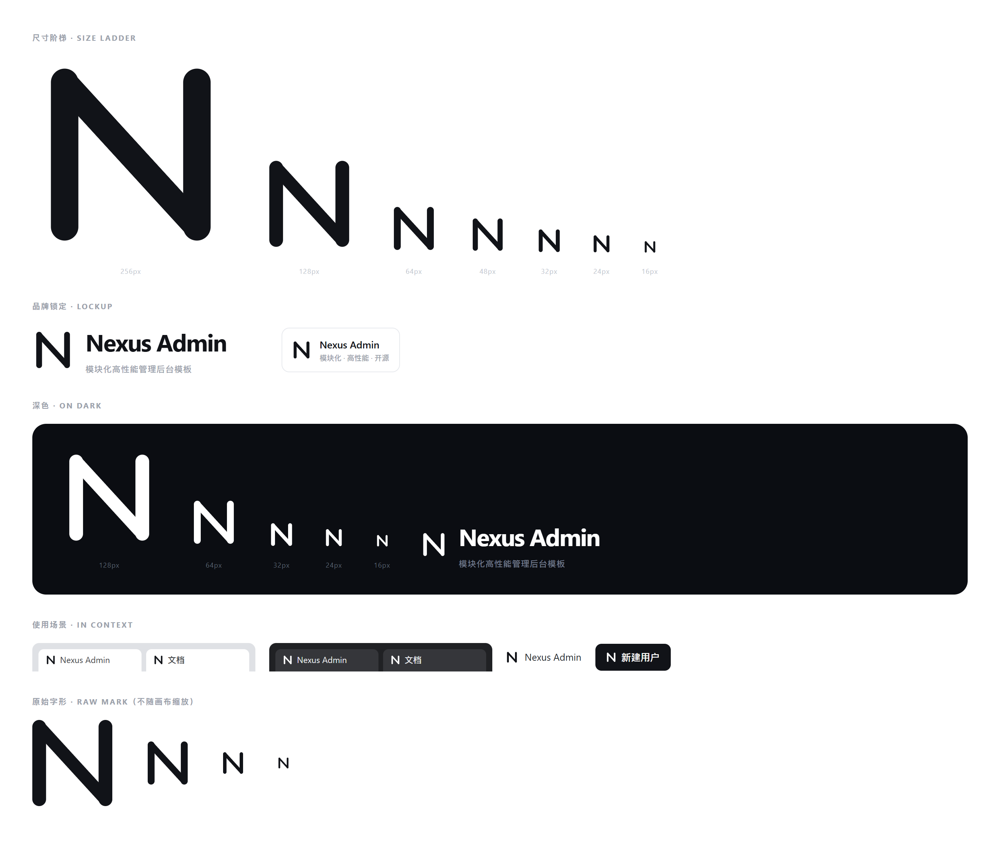

# 品牌规范 · Nexus Admin

图标只有一个字形：**N**。没有底版、没有渐变、没有描边框——两段竖笔加一条斜笔，
换任何颜色、放在任何尺寸下都成立。



---

## 一、字形构成

在 24 × 24 的网格上，用三笔画出一致的圆头线条：

| 元素   | 坐标                       | 说明                               |
| ------ | -------------------------- | ---------------------------------- |
| 左竖笔 | (5.5, 19.1) → (5.5, 4.9)   | 笔宽 2.7，圆头端                   |
| 右竖笔 | (18.5, 19.1) → (18.5, 4.9) | 笔宽 2.7，圆头端                   |
| 斜笔   | (5.5, 4.9) → (18.5, 19.1)  | 笔宽 2.5（斜向视觉偏粗，光学减重） |

- **字宽 13.0 / 字高 14.2**，比例约为 0.92，接近等宽但略高，视觉上更稳。
- 斜笔比竖笔细 0.2：同样粗细的斜线在视网膜上看起来会更重，这是一处光学补偿。
- 三条笔画全部 `stroke-linecap="round"`，所以端点本身就是自然的圆角，无需额外处理。
- 斜笔就是两个字宽的「连接线」——这也是 `Nexus`（连结）这个项目名在图上的落点。

### 为什么不需要底版

管理后台的 UI 是密而静的信息界面。原方案用蓝紫渐变方块 + 白色字母，
在 16px 侧边栏、浏览器页签里会被压成一块模糊的色斑，而且渐变在任何一次换肤时都会和主色打架。
去掉底版后：

- 图标颜色 = 文字颜色（`currentColor`），换主题、换强调色都不用改素材；
- 任何尺寸只损失笔画粗细，不会出现「色块糊在一起」；
- 在深色导航、浅色文档、黑白印刷里都是同一套文件。

---

## 二、文件清单

```
brand/
├── nexus-mark.svg          主字形，墨迹紧边界 viewBox，currentColor
├── nexus-mark-black.svg    固定 #111318（浅底）
├── nexus-mark-white.svg    固定 #ffffff（深底）
├── nexus-icon.svg          24 方画布版本，笔画略加粗（favicon / 应用图标语义）
├── nexus-favicon.svg       透明底 + prefers-color-scheme 自动黑白反转
├── nexus-avatar.svg        深色方块反白（必须不透明的场景）
├── png/
│   ├── nexus-icon-{16,24,32,48,64,128,256,512}.png   透明，≤32px 已做加粗补偿
│   ├── nexus-icon-white-{256,512}.png
│   ├── nexus-avatar-{256,512}.png                   深底反白方块
│   ├── apple-touch-icon-180.png                     iOS 主屏（不透明直角）
│   └── favicon.ico                                  48×48 内嵌 PNG
├── preview/
│   ├── icon-preview.png     尺寸阶梯 / 锁定 / 深色 / 场景
│   ├── og-image.png         1280×640 仓库社交预览
│   └── in-app-*.png         实际跑起来后的截图
└── build.mjs                生成器（改几何只改这里的 CORE 常量）
```

重新生成全部素材：

```bash
node brand/build.mjs
```

脚本会先写 SVG，再用本机 Edge / Chrome 光栅化 PNG 与预览图，无需额外依赖。

---

## 三、使用方式

### React（应用内）

```tsx
import { NexusMark } from '@/components/brand-icons'

// 颜色跟随文字，尺寸按高度给
;<NexusMark className="h-6 w-auto text-fg" />
```

`viewBox` 取的是墨迹紧边界（`4.15 3.55 15.7 16.9`），
所以 `h-6` 拿到的就是字形本身的高度，不必再手动减掉画布留白。

### HTML / 静态页

```html

```

### 文档站（VitePress）

`logo` 已配置为 `{ light, dark }` 双文件，深色模式自动切换白色版。

---

## 四、使用规则

**可以**

- 单色使用：`#111318`（浅底）、`#ffffff`（深底）、或跟随语义色（如主色 `#0d6efd`）。
- 与文字组成锁定：字形高度约等于文字字号，间距 0.6 × 字形高度。
- 需要「图标块」观感时，用 `nexus-avatar.svg` 的深底反白版本。

**不要**

- ❌ 给字形加渐变、投影、描边或底版——那会回到 16px 下糊成一团的老问题。
- ❌ 单独使用白色字形放在浅色背景上（会消失），反之亦然。
- ❌ 拉伸、旋转、改笔画粗细或圆角。缩放请直接换对应尺寸的 PNG/SVG。
- ❌ 在字形周围加圆形或方形的装饰框——图标本身已经足够识别。

### 最小尺寸

| 场景             | 尺寸    | 用哪个文件                        |
| ---------------- | ------- | --------------------------------- |
| 浏览器页签       | 16px    | `favicon.svg`（自动反转）/ `.ico` |
| 侧边栏、导航     | 20–24px | `nexus-icon.svg`（或 React）      |
| 应用图标、头像   | ≥ 64px  | `nexus-avatar.svg`                |
| 品牌展示、社交图 | ≥ 128px | `nexus-mark.svg`                  |

低于 16px 不建议使用；16px 以下字形的斜笔与竖笔间距会小于 1 像素。

### 浏览器页签（favicon）落地

`brand/build.mjs` 会把下面这几个文件**直接同步到 `apps/admin/public/`**，不要手动复制：

| 文件                            | 作用                                                     |
| ------------------------------- | -------------------------------------------------------- |
| `favicon.svg`                   | 首选。透明底 + `prefers-color-scheme` 自动黑白反转       |
| `favicon.ico`                   | 旧浏览器 / 部分书签栏回落，48px 透明底                   |
| `apple-touch-icon.png`          | iOS 主屏，180px 不透明深底（iOS 不支持透明，会自己裁角） |
| `icon-192.png` / `icon-512.png` | PWA / Android 主屏，由 `manifest.webmanifest` 引用       |

`index.html` 只声明 4 个入口（svg / ico / apple-touch / manifest）。**不要**再额外挂
固定颜色的 16px、32px PNG：深色页签里浏览器会挑到那张固定深色的图，反而看不清。

---

## 五、配色

图标本身不带颜色，以下是被它「借用」的既有品牌色：

| 用途       | 值        | 来源                                   |
| ---------- | --------- | -------------------------------------- |
| 浅底墨色   | `#111318` | 比正文 `--n-fg` 略深，保证小尺寸对比度 |
| 深底反白   | `#ffffff` | —                                      |
| 需要着色时 | `#0d6efd` | `--n-primary`（默认强调色）            |

深浅两套主题切换时图标自动反转，不需要额外维护两套 PNG。

---

## 六、在项目中的落点

| 位置            | 文件                                                                                         |
| --------------- | -------------------------------------------------------------------------------------------- |
| 浏览器页签      | `apps/admin/public/favicon.svg` + `favicon.ico`                                              |
| PWA / iOS 图标  | `apps/admin/public/{manifest.webmanifest, apple-touch-icon.png, icon-192.png, icon-512.png}` |
| 侧边栏 Logo     | `apps/admin/src/layout/sidebar-parts.tsx` → `<NexusMark />`                                  |
| 登录页品牌区    | `apps/admin/src/pages/login-page.tsx` → `<NexusMark />`                                      |
| 字标组件        | `apps/admin/src/components/brand-icons.tsx`                                                  |
| 文档站页签      | `apps/docs/public/favicon.svg`                                                               |
| 文档站导航 Logo | `apps/docs/public/logo.svg` + `logo-white.svg`                                               |
| GitHub 社交图   | `brand/preview/og-image.png`（在仓库 Settings → Social preview 上传）                        |
| 页签实拍对比    | `brand/preview/favicon-in-browser.png`                                                       |
